# ProposalAI

**Win more freelance jobs with proposals that sound like you.**

ProposalAI is an AI-powered proposal assistant for freelancers. Set up your profile once, paste a job description, and get a job analysis, a tailored proposal, an honest score with feedback, and win-rate tracking.

**Live demo:** https://your-deployment.vercel.app <!-- replace with the real URL -->
**Repository:** https://github.com/<your-username>/<your-repo> <!-- replace -->

Built as the capstone project for the FlyRank frontend AI engineering internship.

---

## Problem and solution

Freelancers spend hours writing proposals that end up sounding generic, and clients can tell. ProposalAI helps by:

- **Analyzing** each job post: client needs, required skills, skill match and gaps, red flags, clarifying questions and a rough price/timeline estimate.
- **Generating** a proposal from your real profile (skills, projects, portfolio links) in your chosen tone and length, in the style of the platform you are applying on.
- **Scoring** the result honestly, flagging statements that your profile does not support, and suggesting a stronger opening.
- **Tracking** outcomes (sent, replied, won, lost) so you can see what works.

---

## Features

| Feature | Description |
|---|---|
| Profile and projects | Name, headline, skills, portfolio links, default tone and length, and a list of past projects. This is the only source of facts the AI may use. |
| Job analysis | One AI call returns structured JSON: summary, client needs, required skills, skill match and gaps, red flags, 3 clarifying questions, and a price/timeline estimate labelled as an AI estimate. |
| Proposal generation | Platform-aware proposals for Upwork, Fiverr, Freelancer and PeoplePerHour. Choose tone (professional, friendly, confident, concise) and length (short, medium, long). Output is streamed into the editor. |
| Editor | Plain-text editor with debounced autosave, unsaved-changes indicator, word and character count, copy button, and a confirmation before regenerating over edited text. |
| Proposal score | Scores a proposal from 0 to 100 across 5 dimensions (hook, relevance, specificity, clarity and length, call to action), lists strengths and improvements, flags unsupported claims, and suggests a better opening. The score is feedback, not a prediction of winning. |
| History and status | List of your proposals with filters (status, platform), search over the job text, status updates (draft, sent, replied, won, lost) and delete. |
| Dashboard | Summary cards, breakdown by platform and tone, proposals per week, and a "not enough data yet" note whenever a rate is based on fewer than 5 proposals. |
| Settings | Default tone and length, account email, sign out, and a "delete all my proposals" action. |
| Health check | Public `/health` page and `/api/health` endpoint reporting app status, Supabase reachability, and whether the AI service is configured (yes or no). |

### Pages and API routes

| Route | Purpose |
|---|---|
| `/` | Landing page |
| `/signup`, `/login` | Authentication |
| `/dashboard` | Stats and win-rate overview |
| `/profile` | Profile and projects |
| `/proposals` | History and status |
| `/proposals/new` | Paste a job and analyze it |
| `/proposals/[id]` | Analysis, editor and score |
| `/settings` | Preferences and account |
| `/health` | Status page |
| `POST /api/analyze` | Job analysis |
| `POST /api/proposals/[id]/generate` | Proposal generation (streamed) |
| `POST /api/proposals/[id]/score` | Proposal score |
| `POST /api/proposals/[id]/save` | Save edited text |
| `GET /api/health` | Health check |

---

## Tech stack

| Layer | Technology |
|---|---|
| Framework | [Next.js](https://nextjs.org/) 16 (App Router) and React 19 |
| Styling | [Tailwind CSS](https://tailwindcss.com/) 4 |
| Auth and database | [Supabase](https://supabase.com/) (Auth, Postgres, Row Level Security) |
| AI | [Groq](https://groq.com/) API (free tier) through `groq-sdk` |
| Validation | [Zod](https://zod.dev/) 4 |
| Icons | [Lucide](https://lucide.dev/) |
| Hosting | [Vercel](https://vercel.com/) |

---

## Architecture and data flow

```mermaid
flowchart LR
    A["Profile and projects"] --> B["POST /api/analyze"]
    B --> C["proposals row (analysis JSON)"]
    C --> D["POST /api/proposals/:id/generate"]
    D --> E["proposals row (proposal_text)"]
    E --> F["POST /api/proposals/:id/score"]
    F --> G["proposals row (score JSON)"]
    G --> H["/proposals (history and status)"]
    H --> I["/dashboard (win rate)"]
```



1. The user fills in a profile with skills, portfolio links and projects.
2. The user pastes a job description and chooses a platform. **Analyze** makes one Groq call and stores the result in a new `proposals` row.
3. The proposal page is opened for that row's `id`. **Generate** streams a proposal and saves the final text to the same row.
4. The user edits the text (autosave) and can **Score** it. The score is stored in the same row.
5. The user updates the status as the application progresses, and the dashboard aggregates the outcomes.

---

## AI design decisions

- **Three focused AI calls per proposal** (analyze, generate, score), each with its own prompt. This keeps usage low on a free tier.
- **Structured output is validated.** Analysis and score responses are JSON validated with Zod schemas, with one retry on invalid output.
- **Profile facts only.** The generation prompt tells the model to use only skills, projects and links from the profile, never to invent experience, clients or numbers, and never to claim skills that the analysis listed as gaps.
- **Unsupported-claims check.** The score response includes a list of statements in the proposal that the profile does not back up.
- **Model is configurable.** `GROQ_MODEL` and `GROQ_MODEL_GENERATE` select the models (default `openai/gpt-oss-120b`), so a retired model can be swapped without code changes.
- **Free tier only.** No paid AI plan is required.
- **Usage caps.** Per-user limits are enforced with the `ai_usage` table (defaults: 10 analyses per hour, 30 generations per day, 30 scores per day, all configurable). Setting `AI_DISABLED=true` makes the AI endpoints return 503.
- **Honest labelling.** Prices and timelines are shown as AI estimates, and dashboard rates always show their sample size.

---

## Security

- **Row Level Security on every table** (`profiles`, `projects`, `proposals`, `ai_usage`). Users can only read and write their own rows.
- **Server-side secrets only.** The Groq API key is used only in server route handlers and is never sent to the browser.
- **No service role key.** The app uses only the Supabase publishable key together with RLS.
- **Protected routes.** A request proxy (Next.js middleware) refreshes the Supabase session and redirects unauthenticated users to `/login`.
- **Input validation.** API routes validate request bodies with Zod and return clear errors without logging job or proposal text.

---

## Database

The full schema for a **fresh** Supabase project is in [`supabase/schema.sql`](supabase/schema.sql). Incremental changes are in [`supabase/migrations/`](supabase/migrations/).

| Table | Purpose |
|---|---|
| `profiles` | Freelancer profile, skills, portfolio links, default tone and length (created automatically at signup) |
| `projects` | Past projects used as evidence in proposals |
| `proposals` | Job text, analysis JSON, proposal text, score JSON, status |
| `ai_usage` | Per-user AI call log used for usage caps |

---

## Repository structure

```
capstone-project/
├── capstone-flyrank-next/     # Next.js application
│   └── src/
│       ├── app/               # pages and API routes
│       ├── components/        # UI components (editor, forms, lists)
│       ├── lib/               # AI calls and usage caps
│       └── utils/supabase/    # Supabase clients and session handling
├── supabase/                  # schema.sql and migrations/
├── docs/screenshots/          # screenshots used in this README
├── AGENTS.md                  # rules for AI coding assistants
└── PROJECT_CONTEXT.md         # project context for AI coding assistants
```

---

## Local setup

### Prerequisites

- Node.js 20 or newer
- A [Supabase](https://supabase.com/) project (free tier works)
- A [Groq](https://console.groq.com/) API key (free tier works)

### Steps

```bash
# 1. Clone the repo and enter the app folder
git clone https://github.com/<your-username>/<your-repo>.git
cd <your-repo>/capstone-flyrank-next

# 2. Install dependencies
npm install

# 3. Create your env file, then fill in the values
cp .env.example .env.local        # on Windows PowerShell: Copy-Item .env.example .env.local

# 4. Create the database in the Supabase SQL Editor
#    Fresh project: run ../supabase/schema.sql once (it already includes everything).
#    Existing project: run only the files in ../supabase/migrations/ that you have not applied yet.

# 5. Start the dev server
npm run dev
```

The app runs at `http://localhost:3000`.

### Supabase auth settings

- Authentication, Providers, Email must be enabled.
- During development "Confirm email" is turned off so test accounts can sign in immediately. Turn it on for production if you configure an email provider.
- Authentication, URL Configuration: set the Site URL and Redirect URLs to your app URL (`http://localhost:3000` and your Vercel URL).

### Quality checks

```bash
npx tsc --noEmit
npm run lint
```

---

## Environment variables

| Variable | Purpose | Required |
|---|---|---|
| `NEXT_PUBLIC_SUPABASE_URL` | Supabase project URL | Yes |
| `NEXT_PUBLIC_SUPABASE_PUBLISHABLE_KEY` | Supabase publishable (anon) key | Yes |
| `GROQ_API_KEY` | Groq API key, server side only | Yes |
| `GROQ_MODEL` | Groq model for analysis and scoring | No (default `openai/gpt-oss-120b`) |
| `GROQ_MODEL_GENERATE` | Model override for proposal generation | No (falls back to `GROQ_MODEL`) |
| `AI_DISABLED` | Set to `true` to disable all AI endpoints | No (default `false`) |
| `AI_LIMIT_ANALYZE_PER_HOUR` | Analyses per user per hour | No (default `10`) |
| `AI_LIMIT_GENERATE_PER_DAY` | Generations per user per day | No (default `30`) |
| `AI_LIMIT_SCORE_PER_DAY` | Scores per user per day | No (default `30`) |

A ready-to-copy template is in [`capstone-flyrank-next/.env.example`](capstone-flyrank-next/.env.example). Never commit `.env.local`.

---

## Deployment on Vercel

1. Push the repository to GitHub.
2. Import it in Vercel and set **Root Directory** to `capstone-flyrank-next`.
3. Add the environment variables from the table above. Do not add a `NEXT_PUBLIC_` prefix to the Groq key.
4. Deploy. Vercel detects Next.js automatically.
5. In Supabase, set the Site URL and Redirect URLs to the deployed URL.
6. Open `/health` on the deployed site and confirm that Supabase is reachable and the AI service is configured.

---

## Known limitations

- **Free-tier rate limits.** Groq's free tier can return 429 errors under heavy use. Per-user usage caps help, but they do not remove the provider's limits.
- **Models get retired.** Groq retires models from time to time. If requests fail with a "model not found" error, change `GROQ_MODEL` or `GROQ_MODEL_GENERATE`.
- **The "profile facts only" rule is a prompt instruction, not a guarantee.** The unsupported-claims check is also an AI model, so it can miss things. Always read a generated proposal before sending it.
- **Estimates are not market data.** Price and timeline suggestions are rough signals, and the score is feedback rather than a prediction.
- **Small samples.** Win and reply rates based on a handful of proposals are not statistically meaningful. The dashboard shows the sample size next to every rate.
- **Single user per account.** There is no sharing or collaboration between accounts.
- **English prompts.** Prompts are written in English, so non-English job posts may give weaker results.

---
## Author

Rabia Naseer

## License

MIT, see [LICENSE](LICENSE).