# ProposalAI

**Win more freelance jobs with proposals that sound like you.**

ProposalAI is an AI-powered proposal assistant for freelancers. Set up your profile once, paste a job description, and get a job analysis, a tailored proposal, an honest score with feedback, and win-rate tracking.

**Live demo:** https://capstone-flyrank-five.vercel.app
**Repository:** https://github.com/Rabia-1275capstone-flyrank

Built as the capstone project for the FlyRank frontend AI engineering internship.

---

## Problem and solution

Freelancers spend hours writing proposals that end up sounding generic, and clients can tell. ProposalAI helps by:

- **Analyzing** each job post: client needs, required skills, skill match and gaps, red flags, clarifying questions and a rough price/timeline estimate.
- **Generating** a proposal from your real profile (skills, projects, portfolio links) in your chosen tone and length, in the style of the platform you are applying on.
- **Scoring** the result honestly, flagging statements that your profile does not support, and suggesting a stronger opening.
- **Tracking** outcomes (sent, replied, won, lost) so you can see what works.

---

## Features

| Feature | Description |
|---|---|
| Profile and projects | Name, headline, skills, portfolio links, default tone and length, and a list of past projects. This is the only source of facts the AI may use. |
| Job analysis | One AI call returns structured JSON: summary, client needs, required skills, skill match and gaps, red flags, 3 clarifying questions, and a price/timeline estimate labelled as an AI estimate. |
| Proposal generation | Platform-aware proposals for Upwork, Fiverr, Freelancer and PeoplePerHour. Choose tone (professional, friendly, confident, concise) and length (short, medium, long). Output is streamed into the editor. |
| Editor | Plain-text editor with debounced autosave, unsaved-changes indicator, word and character count, copy button, and a confirmation before regenerating over edited text. |
| Proposal score | Scores a proposal from 0 to 100 across 5 dimensions (hook, relevance, specificity, clarity and length, call to action), lists strengths and improvements, flags unsupported claims, and suggests a better opening. The score is feedback, not a prediction of winning. |
| History and status | List of your proposals with filters (status, platform), search over the job text, status updates (draft, sent, replied, won, lost) and delete. |
| Dashboard | Summary cards, breakdown by platform and tone, proposals per week, and a "not enough data yet" note whenever a rate is based on fewer than 5 proposals. |
| Settings | Default tone and length, account email, sign out, and a "delete all my proposals" action. |
| Health check | Public `/health` page and `/api/health` endpoint reporting app status, Supabase reachability, and whether the AI service is configured (yes or no). |

### Pages and API routes

| Route | Purpose |
|---|---|
| `/` | Landing page |
| `/signup`, `/login` | Authentication |
| `/dashboard` | Stats and win-rate overview |
| `/profile` | Profile and projects |
| `/proposals` | History and status |
| `/proposals/new` | Paste a job and analyze it |
| `/proposals/[id]` | Analysis, editor and score |
| `/settings` | Preferences and account |
| `/health` | Status page |
| `POST /api/analyze` | Job analysis |
| `POST /api/proposals/[id]/generate` | Proposal generation (streamed) |
| `POST /api/proposals/[id]/score` | Proposal score |
| `POST /api/proposals/[id]/save` | Save edited text |
| `GET /api/health` | Health check |

---

## Tech stack

| Layer | Technology |
|---|---|
| Framework | [Next.js](https://nextjs.org/) 16 (App Router) and React 19 |
| Styling | [Tailwind CSS](https://tailwindcss.com/) 4 |
| Auth and database | [Supabase](https://supabase.com/) (Auth, Postgres, Row Level Security) |
| AI | [Groq](https://groq.com/) API (free tier) through `groq-sdk` |
| Validation | [Zod](https://zod.dev/) 4 |
| Icons | [Lucide](https://lucide.dev/) |
| Testing | [Vitest](https://vitest.dev/) and React Testing Library |
| Hosting | [Vercel](https://vercel.com/) |

---

## Architecture and data flow

```mermaid
flowchart LR
    A["Profile and projects"] --> B["POST /api/analyze"]
    B --> C["proposals row (analysis JSON)"]
    C --> D["POST /api/proposals/:id/generate"]
    D --> E["proposals row (proposal_text)"]
    E --> F["POST /api/proposals/:id/score"]
    F --> G["proposals row (score JSON)"]
    G --> H["/proposals (history and status)"]
    H --> I["/dashboard (win rate)"]
```



1. The user fills in a profile with skills, portfolio links and projects.
2. The user pastes a job description and chooses a platform. **Analyze** makes one Groq call and stores the result in a new `proposals` row.
3. The proposal page is opened for that row's `id`. **Generate** streams a proposal and saves the final text to the same row.
4. The user edits the text (autosave) and can **Score** it. The score is stored in the same row.
5. The user updates the status as the application progresses, and the dashboard aggregates the outcomes.

---

## AI design decisions

- **Three focused AI calls per proposal** (analyze, generate, score), each with its own prompt. This keeps usage low on a free tier.
- **Structured output is validated.** Analysis and score responses are JSON validated with Zod schemas, with one retry on invalid output.
- **Profile facts only.** The generation prompt tells the model to use only skills, projects and links from the profile, never to invent experience, clients or numbers, and never to claim skills that the analysis listed as gaps.
- **Unsupported-claims check.** The score response includes a list of statements in the proposal that the profile does not back up.
- **Model is configurable.** `GROQ_MODEL` and `GROQ_MODEL_GENERATE` select the models (default `openai/gpt-oss-120b`), so a retired model can be swapped without code changes.
- **Free tier only.** No paid AI plan is required.
- **Usage caps.** Per-user limits are enforced with the `ai_usage` table (defaults: 10 analyses per hour, 30 generations per day, 30 scores per day, all configurable). Setting `AI_DISABLED=true` makes the AI endpoints return 503.
- **Honest labelling.** Prices and timelines are shown as AI estimates, and dashboard rates always show their sample size.

### The prompts

All AI calls live in [`capstone-flyrank-next/src/lib/ai.ts`](capstone-flyrank-next/src/lib/ai.ts). Each call sends one system prompt and one user message. The user message is always `Job Description:\n<job text>` (the score call also appends `Candidate Proposal:\n<proposal text>`). Values in `${...}` are filled in at request time.

**1. Analyze** (`analyzeJob`, JSON mode, model `GROQ_MODEL`)

```text
You are an expert freelance job analyzer for platforms like ${platform}.
Base your match on the provided profile ONLY. Do not invent skills or experience.
Treat portfolio_links and project links as provided evidence of past work and verified portfolio items. Do NOT claim "No portfolio links provided" if portfolio_links or project links are present.
Treat pricing as a rough estimate.
Always return your response in JSON format exactly matching the following schema.
Ensure your response is parseable JSON.

Schema: { summary, client_needs[], required_skills[], skill_match { matched[], gaps[] },
          red_flags[], clarifying_questions[3], pricing { model: "fixed" | "hourly",
          low, high, currency: "USD", timeline_days, reasoning } }

Profile Information: full name, headline, skills, tone, portfolio links
Projects: one line per project (title, description, link)
```

**2. Generate** (`generateProposalStream`, streamed, model `GROQ_MODEL_GENERATE`, `max_tokens` 700 / 1000 / 1400 for short / medium / long)

```text
You are a freelance professional generating a proposal on ${platform}.
Write in first person. Sign off using the name "${fullName}". Do not use placeholders like [Your Name].
Use ONLY skills, projects and links present in the profile. Never invent experience, clients, numbers or skills.
Do not claim skills listed in skill gaps (${gaps}).
NEVER mention missing skills, gaps, or lack of experience, and never compare ("rather than", "even though I only..."). Do not apologize. Focus only on relevant strengths that exist in the profile; if experience is thin, spend the space on the client's goal and one concrete question.
Describe a project using ONLY facts from its description. If a project has no description, mention its name and link only, with no details about what it does, how it performs, or what technology it uses.
Reference 1-2 specific details from the job so it does not read generic.

Platform style rules:
- upwork: strong first two lines, about 150-250 words, end with one clarifying question.
- fiverr: short and direct, about 100-150 words.
- freelancer: mention timeline and price clearly, about 150-200 words.
- peopleperhour: professional, about 150-200 words.

Requested Tone: ${tone}
Requested Length: ${length}

Formatting rules:
- Plain text output only, no emojis.
- Do not use any markdown: no **bold**, no # headings, no backticks, no bullet symbols other than plain hyphens.

Profile Information: name, headline, skills, portfolio links
Projects: one line per project (title, description, link)
```

**3. Score** (`scoreProposal`, JSON mode, model `GROQ_MODEL`, `max_tokens` 1500)

```text
You are an expert proposal reviewer and coach for freelance clients.
Evaluate the candidate's proposal strictly against the provided job description and profile.
Be specific, constructive, and honest (do not inflate scores). Never invent facts.
Label the result as feedback, not a prediction of winning.

Evaluation guidelines:
- overall: overall quality score from 0 to 100 based on the breakdown.
- breakdown: hook, relevance, specificity, clarity_length, call_to_action
  (each a 0-10 score with specific feedback)
- strengths: list of up to 3 strong points in the proposal (strings).
- improvements: list of up to 3 high-impact areas for improvement (strings).
- unsupported_claims: list of statements in the proposal that are NOT backed by the candidate's profile or projects (strings). Return empty array if none found.
- better_opening: a rewritten first two lines for the proposal using ONLY real facts from the candidate's profile.

Return ONLY valid JSON matching this schema: { overall, breakdown { ... }, strengths[],
improvements[], unsupported_claims[], better_opening }

Candidate Profile: name, headline, skills, portfolio links, skill gaps identified
Candidate Projects: one line per project (title, description, link)
```

The schema, breakdown and profile blocks are shortened here; the exact text is in `ai.ts`.

### Why the prompts are written this way

- **The profile goes in the system prompt, the job in the user message.** The profile is the only trusted source of facts, so it sits with the instructions. The job post is third-party text, so it is kept in its own message.
- **"ONLY" and "Never invent" appear in every prompt.** The main risk in this product is a proposal that claims experience the freelancer does not have. Analyze, Generate and Score each restate the rule so no call relies on another to enforce it.
- **Gaps flow from Analyze into Generate and Score.** Generate is told not to claim them, and Score sees them when it looks for unsupported claims.
- **"Never mention missing skills" and "Do not apologize".** Without this, the model tends to write things like "even though I only have...", which weakens a proposal. The prompt redirects that space to the client's goal and one question.
- **Projects without a description get name and link only.** Otherwise the model guesses what a project does from its title, which is an invented claim.
- **Platform style rules** encode the length and structure each marketplace favours (for example, a strong first two lines for Upwork, price and timeline for Freelancer).
- **Plain-text formatting rules.** Proposals are pasted into marketplace text boxes, where markdown shows up as stray `**` and `#`. `cleanProposalText` strips any that slip through.
- **JSON mode, the schema in the prompt and Zod validation** for Analyze and Score, with one retry. The UI renders these fields directly, so a malformed response fails with an error instead of rendering a half-empty card.
- **"Do not inflate scores" and "feedback, not a prediction of winning".** This asks for a coaching score and keeps the UI from implying a win probability.
- **`reasoning_effort: 'low'` and a `max_tokens` cap per length** keep latency and token use low on the free tier.

### AI limitations

These rules are instructions to a model, not guarantees. The unsupported-claims check is itself an AI call and can miss claims or flag true ones. Prices are rough estimates, not market data. See [Known limitations](#known-limitations) for the full list.

---

## Security

- **Row Level Security on every table** (`profiles`, `projects`, `proposals`, `ai_usage`). Users can only read and write their own rows.
- **Server-side secrets only.** The Groq API key is used only in server route handlers and is never sent to the browser.
- **No service role key.** The app uses only the Supabase publishable key together with RLS.
- **Protected routes.** A request proxy (Next.js middleware) refreshes the Supabase session and redirects unauthenticated users to `/login`.
- **Input validation.** API routes validate request bodies with Zod and return clear errors without logging job or proposal text.

---

## Accessibility

The interface was audited with axe DevTools (WCAG 2.1 AA) on the production site, and the failures it found were fixed in code: text contrast, labels that were not linked to their inputs, and links that were distinguished by color only. The audit results, the before and after scans, and the exact fixes are written up in [`docs/PORTFOLIO_ENTRY.md`](docs/PORTFOLIO_ENTRY.md#5-lighthouse-and-accessibility).

---

## Database

The full schema for a **fresh** Supabase project is in [`supabase/schema.sql`](supabase/schema.sql). Incremental changes are in [`supabase/migrations/`](supabase/migrations/).

| Table | Purpose |
|---|---|
| `profiles` | Freelancer profile, skills, portfolio links, default tone and length (created automatically at signup) |
| `projects` | Past projects used as evidence in proposals |
| `proposals` | Job text, analysis JSON, proposal text, score JSON, status |
| `ai_usage` | Per-user AI call log used for usage caps |

---

## Repository structure

```
capstone-project/
├── capstone-flyrank-next/     # Next.js application
│   └── src/
│       ├── app/               # pages and API routes
│       ├── components/        # UI components (editor, forms, lists)
│       ├── lib/               # AI calls and usage caps
│       ├── tests/             # Vitest tests (components, lib, app)
│       └── utils/supabase/    # Supabase clients and session handling
├── supabase/                  # schema.sql and migrations/
├── docs/                      # deployment checklist, portfolio entry, test coverage output, screenshots
├── AGENTS.md                  # rules for AI coding assistants
└── PROJECT_CONTEXT.md         # project context for AI coding assistants
```

---

## Local setup

### Prerequisites

- Node.js 20.19 or newer (or 22.12 or newer)
- A [Supabase](https://supabase.com/) project (free tier works)
- A [Groq](https://console.groq.com/) API key (free tier works)

### Steps

```bash
# 1. Clone the repo and enter the app folder
git clone https://github.com/Rabia-1275/capstone-flyrank.git
cd capstone-flyrank/capstone-flyrank-next

# 2. Install dependencies
npm install

# 3. Create your env file, then fill in the values
cp .env.example .env.local        # on Windows PowerShell: Copy-Item .env.example .env.local

# 4. Create the database in the Supabase SQL Editor
#    Fresh project: run ../supabase/schema.sql once (it already includes everything).
#    Existing project: run only the files in ../supabase/migrations/ that you have not applied yet.

# 5. Start the dev server
npm run dev
```

The app runs at `http://localhost:3000`.

### Supabase auth settings

- Authentication, Providers, Email must be enabled.
- During development "Confirm email" is turned off so test accounts can sign in immediately. Turn it on for production if you configure an email provider.
- Authentication, URL Configuration: set the Site URL and Redirect URLs to your app URL (`http://localhost:3000` and your Vercel URL).

### Quality checks

```bash
npx tsc --noEmit
npm run lint
npm test
```

---

## Testing

Tests use [Vitest](https://vitest.dev/) with React Testing Library in a jsdom environment. Run them from `capstone-flyrank-next/`:

```bash
npm test                # run the whole suite once
npm run test:watch      # re-run on file changes
npm run test:coverage   # run once with a v8 coverage report (text, html in coverage/, lcov)
```

The component tests render the real components with Supabase, server actions and `fetch` mocked. The `src/lib` tests cover the Zod schemas, dashboard aggregation, usage caps and formatting. No test calls Supabase or Groq. On a slow machine the first run can take a couple of minutes because jsdom is started for each test file; the config limits parallel workers to keep it stable.

Result of the last `npm run test:coverage` run: **13 test files, 131 tests, all passing**. The full terminal output is saved in [`docs/test-coverage-output.txt`](docs/test-coverage-output.txt).

| Scope | % Stmts | % Branch | % Funcs | % Lines |
|---|---|---|---|---|
| All files | 61.64 | 46.74 | 53.84 | 62.96 |
| `src/components` | 53.75 | 41.91 | 44.20 | 55.97 |
| `src/lib` | 96.94 | 84.28 | 96.77 | 96.42 |

**Component coverage: 8 of 11 components (73%) have tests.**

| Component | % Stmts | Tested |
|---|---|---|
| Navbar | 100 | yes |
| ProfileCompleteness | 100 | yes |
| ProposalStatusSelect | 92.85 | yes |
| ProfileForm | 86 | yes |
| NewProposalForm | 75 | yes |
| ProposalEditor | 58.6 | yes |
| ProposalsList | 56.25 | yes |
| DashboardContent | 55.88 | yes |
| HealthDashboard | 0 | no |
| ProjectsSection | 0 | no |
| SettingsForm | 0 | no |

There is also a small test for the login page that checks the "Sign up" link stays underlined (accessibility: links must not rely on color alone). `src/lib/ai.ts` is excluded from coverage because it calls the Groq API; its Zod schemas are imported and tested directly.

---

## Environment variables

| Variable | Purpose | Required |
|---|---|---|
| `NEXT_PUBLIC_SUPABASE_URL` | Supabase project URL | Yes |
| `NEXT_PUBLIC_SUPABASE_PUBLISHABLE_KEY` | Supabase publishable (anon) key | Yes |
| `GROQ_API_KEY` | Groq API key, server side only | Yes |
| `GROQ_MODEL` | Groq model for analysis and scoring | No (default `openai/gpt-oss-120b`) |
| `GROQ_MODEL_GENERATE` | Model override for proposal generation | No (falls back to `GROQ_MODEL`) |
| `AI_DISABLED` | Set to `true` to disable all AI endpoints | No (default `false`) |
| `AI_LIMIT_ANALYZE_PER_HOUR` | Analyses per user per hour | No (default `10`) |
| `AI_LIMIT_GENERATE_PER_DAY` | Generations per user per day | No (default `30`) |
| `AI_LIMIT_SCORE_PER_DAY` | Scores per user per day | No (default `30`) |

A ready-to-copy template is in [`capstone-flyrank-next/.env.example`](capstone-flyrank-next/.env.example). Never commit `.env.local`.

---

## Deployment on Vercel

1. Push the repository to GitHub.
2. Import it in Vercel and set **Root Directory** to `capstone-flyrank-next`.
3. Add the environment variables from the table above for **both Production and Preview**. Do not add a `NEXT_PUBLIC_` prefix to the Groq key.
4. Deploy. Vercel detects Next.js automatically.
5. In Supabase, set the Site URL and Redirect URLs to the deployed URL.
6. Open `/health` on the deployed site and confirm that Supabase is reachable and the AI service is configured.

---

## Rollback plan

If a production deploy breaks something, roll back first and debug afterwards.

**Option A: Vercel (fastest, no code change)**

1. In the Vercel dashboard, open the project and go to **Deployments**.
2. Find the last deployment with status **Ready** that was working.
3. Open its `...` menu and choose **Promote to Production** (or **Redeploy** if promote is not offered).

**Option B: git revert**

```bash
git revert -m 1 <merge-commit>
git push origin main
```

Vercel builds and deploys the revert automatically. `-m 1` is for a merge commit; for a single regular commit use `git revert <commit>`.

**After rolling back**

- Open `/health` on the production URL and confirm the app is up, Supabase is reachable and the AI service is configured.
- Log in with a test account and open the dashboard.
- If the bad deploy included a database migration, check that the previous code still works with the new schema.

The full pre-deploy, deploy and post-deploy steps are in [`docs/DEPLOYMENT_CHECKLIST.md`](docs/DEPLOYMENT_CHECKLIST.md).

---

## Known limitations

- **Free-tier rate limits.** Groq's free tier can return 429 errors under heavy use. Per-user usage caps help, but they do not remove the provider's limits.
- **Models get retired.** Groq retires models from time to time. If requests fail with a "model not found" error, change `GROQ_MODEL` or `GROQ_MODEL_GENERATE`.
- **The "profile facts only" rule is a prompt instruction, not a guarantee.** The unsupported-claims check is also an AI model, so it can miss things. Always read a generated proposal before sending it.
- **Estimates are not market data.** Price and timeline suggestions are rough signals, and the score is feedback rather than a prediction.
- **Small samples.** Win and reply rates based on a handful of proposals are not statistically meaningful. The dashboard shows the sample size next to every rate.
- **Test coverage is partial.** 8 of 11 components have tests. HealthDashboard, ProjectsSection and SettingsForm do not, and the end-to-end flow (analyze, generate, score) is not covered by automated tests.
- **Single user per account.** There is no sharing or collaboration between accounts.
- **English prompts.** Prompts are written in English, so non-English job posts may give weaker results.

---
## Author

Rabia Naseer

## License

MIT, see [LICENSE](LICENSE).