# ProposalAI: portfolio entry

## 1. Project brief

ProposalAI helps freelancers write stronger proposals in less time. On platforms like Upwork and Fiverr, writing a tailored proposal for every job takes so long that many freelancers send generic copy-paste messages that clients ignore. ProposalAI analyses a pasted job description against the freelancer's saved profile and projects, drafts a platform-specific proposal that uses only real skills and work, scores it honestly (including flagging claims the profile does not support), and tracks outcomes in a win-rate dashboard. It is built for freelancers, and I chose it because I am one: I wanted a tool where the AI solves a real part of my workflow (analysis, drafting and review) rather than being a chat box.

## 2. Live app

**URL:** https://capstone-flyrank-five.vercel.app

The app is deployed on Vercel from the `main` branch. It is fully functional (sign up, profile, analyze, generate, score, history, dashboard).

**Accessibility (WCAG 2.1 AA).** I ran axe DevTools on the production site, found failures on 7 of the 10 pages I scanned, and fixed all of them in code. The scan results and fixes are in [section 5](#5-lighthouse-and-accessibility). In short:

- **Color contrast:** low-contrast text (an amber note at 2.13:1, a gray badge at 3.9:1) was darkened to meet 4.5:1.
- **Labels:** visible labels that were not linked to their inputs are now linked with `htmlFor` and `id`, and the tone, length and proposal controls on the proposal page have accessible names.
- **Links:** inline links that were told apart only by color are now underlined.
- **Announcements:** AI error boxes use `role="alert"` so screen readers announce failures, and icon-only buttons have `aria-label`s.

## 3. Repository and README

- **Repository:** https://github.com/Rabia-1275/capstone-flyrank
- **README:** https://github.com/Rabia-1275/capstone-flyrank#readme
  - [Local setup](https://github.com/Rabia-1275/capstone-flyrank#local-setup) (clone, `npm install`, env file, `npm run dev`)
  - [Architecture and data flow](https://github.com/Rabia-1275/capstone-flyrank#architecture-and-data-flow)
  - [AI design decisions](https://github.com/Rabia-1275/capstone-flyrank#ai-design-decisions), including [the prompts](https://github.com/Rabia-1275/capstone-flyrank#the-prompts) and [why they are written this way](https://github.com/Rabia-1275/capstone-flyrank#why-the-prompts-are-written-this-way)
  - [Testing](https://github.com/Rabia-1275/capstone-flyrank#testing)
  - [Rollback plan](https://github.com/Rabia-1275/capstone-flyrank#rollback-plan)
  - [Known limitations](https://github.com/Rabia-1275/capstone-flyrank#known-limitations)

## 4. Testing evidence

Vitest and React Testing Library. The numbers below are copied from the last `npm run test:coverage` run, saved in full in [`test-coverage-output.txt`](test-coverage-output.txt).

```text
 Test Files  13 passed (13)
      Tests  131 passed (131)
```

| Scope | % Stmts | % Branch | % Funcs | % Lines |
|---|---|---|---|---|
| All files | 61.64 | 46.74 | 53.84 | 62.96 |
| `src/components` | 53.75 | 41.91 | 44.20 | 55.97 |
| `src/lib` | 96.94 | 84.28 | 96.77 | 96.42 |

**Components with tests: 8 of 11 (73%)**: Navbar, NewProposalForm, ProfileCompleteness, ProfileForm, ProposalEditor, ProposalStatusSelect, ProposalsList and DashboardContent. Not yet tested: HealthDashboard, ProjectsSection and SettingsForm. `src/lib/ai.ts` is excluded from coverage because it calls the Groq API; its Zod schemas are tested directly.

What the tests check (examples): the editor shows a spinner only while generating; an error box with Retry appears on a failed response and on an empty stream; autosave never fires for empty text or while generating; the skills input adds on Enter, rejects duplicates and stops at 20; the new-proposal form needs 50 characters and shows API errors; the status select updates optimistically.

**Screenshot of the terminal coverage table:**

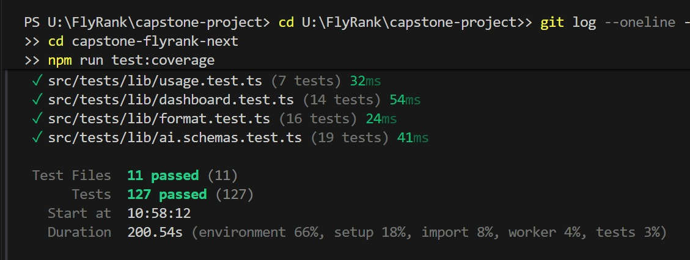

## 5. Lighthouse and accessibility

### Lighthouse (production URL, mobile)

| Page | Performance | Accessibility | Best Practices | SEO |
|---|---|---|---|---|
| `/` | 94 | 100 | 100 | 91 |
| `/proposals/[id]` | 76 | 100 | 100 | 100 |

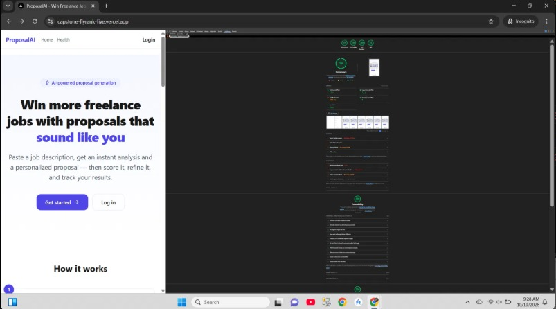

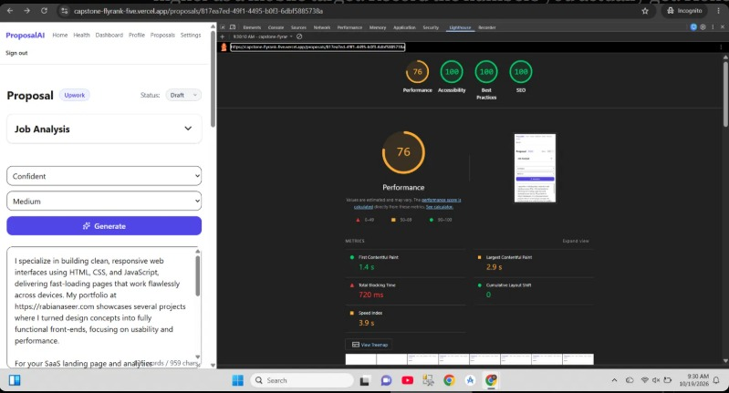

Performance on the proposal page is 76, below the 85 target. Total Blocking Time is 720 ms: this page is a client-rendered editor that loads more JavaScript than the landing page, and Lighthouse throttles the CPU for mobile. First Contentful Paint (1.4 s) and Cumulative Layout Shift (0) are good. Next steps: code-split the editor and score components and lazy-load the analysis panel. Scores were measured on a slow development machine and vary between runs.

### axe DevTools (WCAG 2.1 AA): before

Scanned on the production site before the fixes, with the free axe DevTools extension (axe-core 4.13.0), while logged in for the app pages.

| Page | Issues | Cause |
|---|---|---|
| `/dashboard` | 15 serious | Color contrast: amber `(n=1)` note |
| `/settings` | 1 serious | Color contrast: "Read only" badge |
| `/profile` | 2 | Full Name input and Tone select not linked to their visible labels |
| `/proposals/new` | 1 critical | Platform select had no accessible name |
| `/proposals/[id]` | 3 | Proposal textarea, tone select and length select had no labels |
| `/login` | 1 serious | "Sign up" link distinguished by color only |
| `/signup` | 1 serious | "Log in" link distinguished by color only |
| `/`, `/health`, `/proposals` | 0 | none |

Total: 24 issues from 5 root causes.

### axe DevTools: after

Re-scanned on the production site on 2026-10-19 (commit e2a826c, after PR #2 was merged). Result: **0 issues on all 10 pages.**

| Page | Issues | Screenshot |
|---|---|---|
| `/` | 0 | 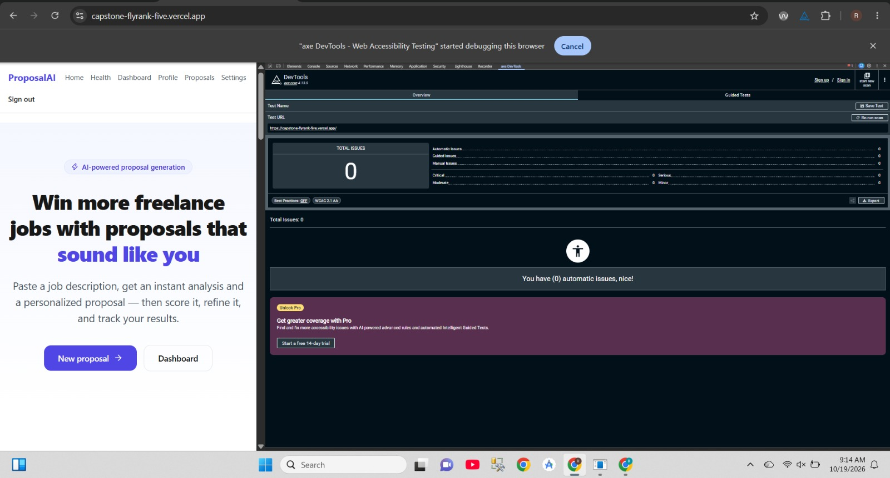 |
| `/health` | 0 | 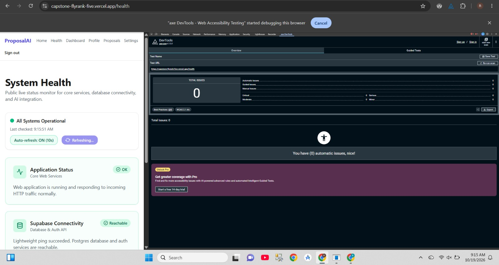 |
| `/login` | 0 | 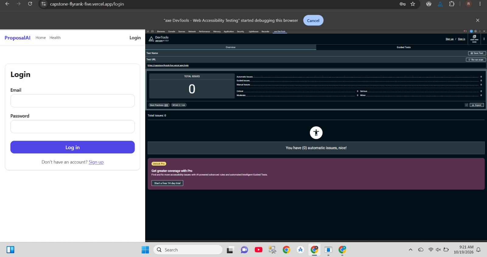 |
| `/signup` | 0 | 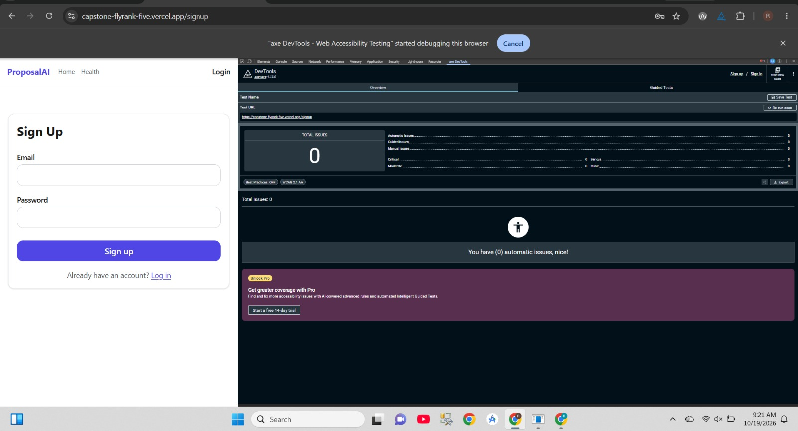 |
| `/dashboard` | 0 | 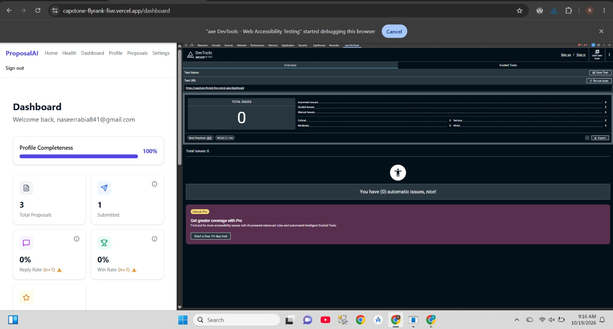 |
| `/profile` | 0 | 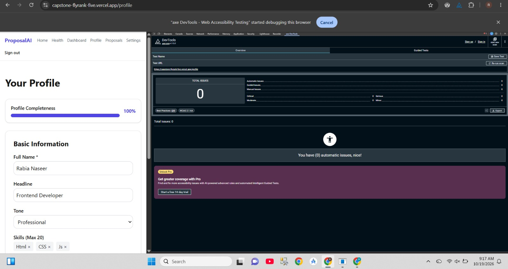 |
| `/settings` | 0 | 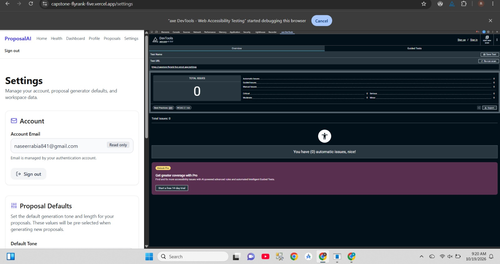 |
| `/proposals` | 0 | 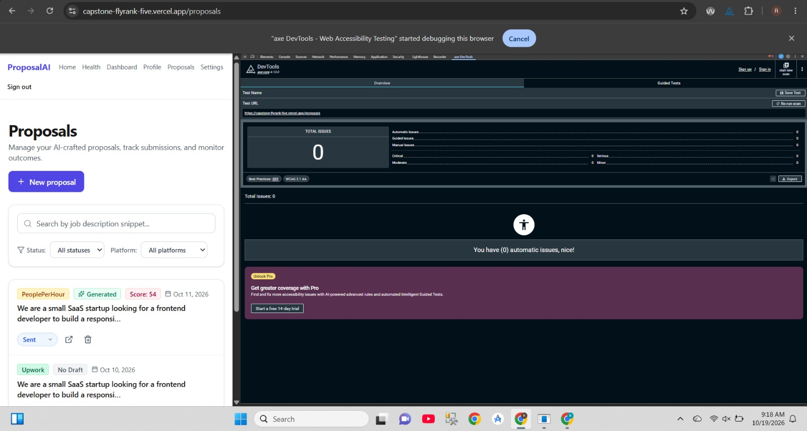 |
| `/proposals/new` | 0 | 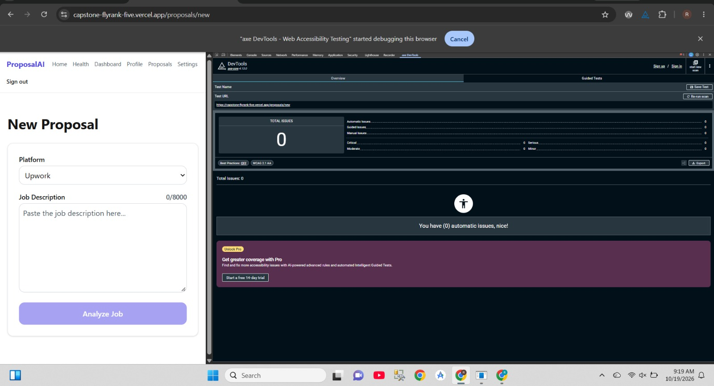 |
| `/proposals/[id]` | 0 | 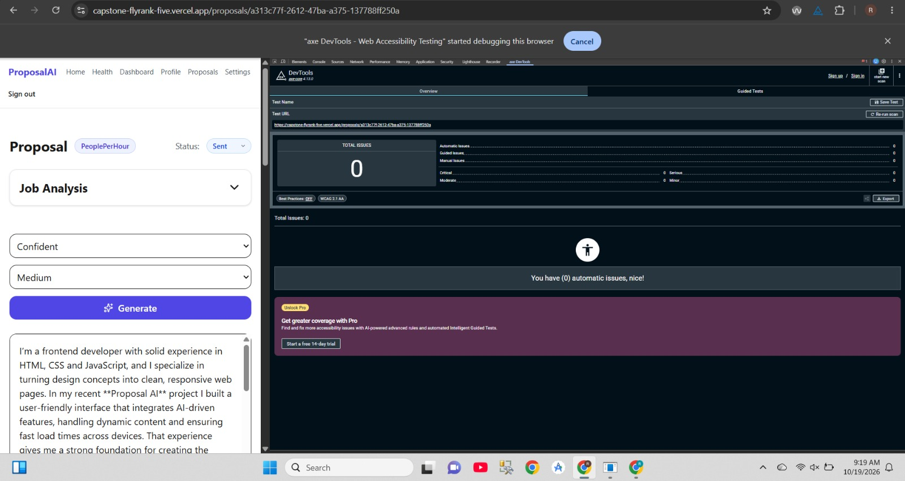 |

### Tool used

I used axe DevTools (axe-core 4.13.0) for the accessibility audit. WAVE was not run.

### One concrete improvement based on the audit: text contrast

- **Finding:** axe reported 15 serious color-contrast failures on `/dashboard`. Every one was the small `(n=1)` sample-size note, which used `text-amber-500` (`#fe9a00`) on white: a contrast ratio of **2.13:1**, where WCAG AA requires 4.5:1 for text this small. The Settings "Read only" badge failed the same rule at 3.9:1 (`#6b7280` on `#e5e7eb`).
- **Fix:** the note now uses `text-amber-700` (`#b45309`, about 5:1 on white). The shared muted color in `globals.css` was darkened from `#6b7280` to `#4b5563` (about 7.5:1 on white and 6:1 on gray-200), so all muted text and the "Read only" badge pass. Placeholder text was set to the same color. The visual design is otherwise unchanged.
- **A test locks it in:** `DashboardContent.test.tsx` asserts that the sample-size note no longer uses `text-amber-500`.
- **Before screenshot:** 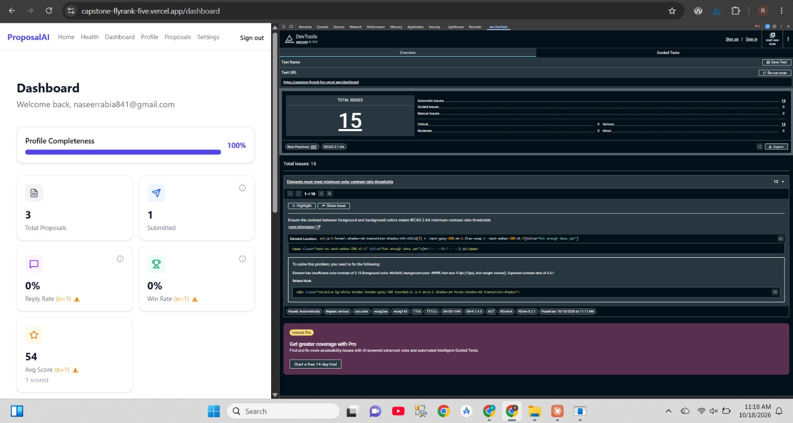
- **After screenshot:** 

### Other fixes from the same audit

- **Labels:** every visible input, select and textarea is now linked to its `<label htmlFor>` with a matching `id` (made with `useId()` so ids do not collide): Platform and Job Description (new proposal), Full Name, Headline, Tone, Skills and Portfolio Links (profile), Title, Description and Link (projects), and the Settings fields. The tone, length and proposal-text controls on the proposal page have screen-reader-only labels. Tests find these controls with `getByLabelText`. (WCAG 1.3.1, 3.3.2, 4.1.2)
- **Links:** the "Sign up" and "Log in" links are always underlined (`underline underline-offset-2`), not only on hover, so they do not rely on color. A small test covers the login page. (WCAG 1.4.1)
- **Announcements:** the AI error box (with Retry), the score error box and the analyze error message have `role="alert"`. (WCAG 4.1.3)
- **Names for icon-only controls:** the copy buttons have an `aria-label`, and the "x" buttons that remove a skill or link read "Remove skill React" instead of "times". (WCAG 4.1.2)

## 6. Deployment checklist, error states, rollback

- **Deployment checklist:** [`DEPLOYMENT_CHECKLIST.md`](DEPLOYMENT_CHECKLIST.md)
  - The production deployment live before this release was commit 6bb91ce (the merge of PR #1); the current one is e2a826c (the merge of PR #2). Rolling back means promoting the 6bb91ce deployment in Vercel.
- **Rollback plan:** [README, Rollback plan](https://github.com/Rabia-1275/capstone-flyrank#rollback-plan) (promote the previous Ready deployment in Vercel, or `git revert` the merge commit and push).

Error-state screenshots:

- AI error box with Retry: 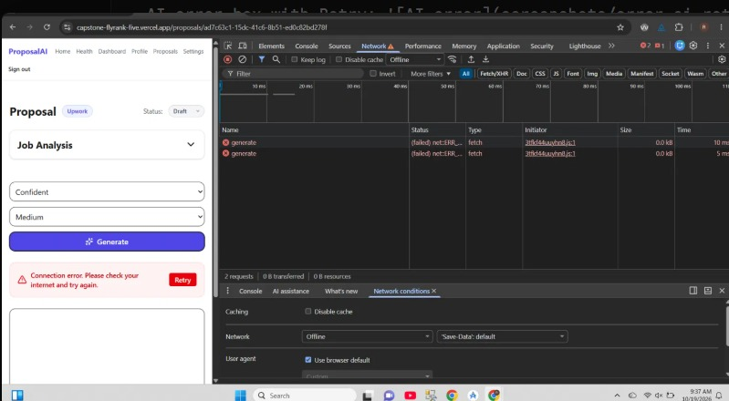
- Recovery after Retry: 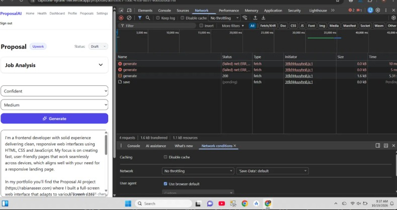
- Usage-limit message: not screenshotted. The caps are enforced in `src/lib/usage.ts` and covered by unit tests (under limit, over limit, AI_DISABLED).
- Custom 404 page: 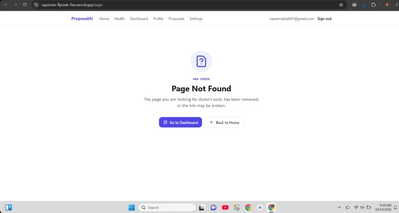
- `/health` page: 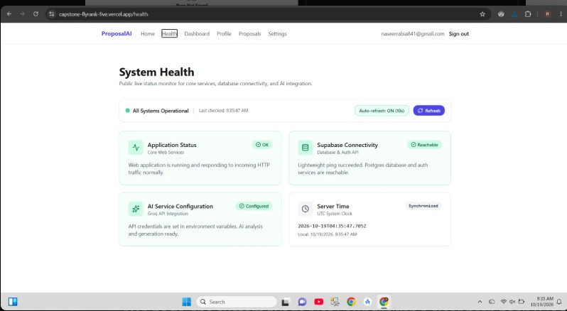

## 7. Reflection

**What was hardest?**

The hardest part was bugs that did not show any error. The worst one was in proposal generation. The button worked and the request finished, but the proposal came back empty. A database status constraint was failing quietly, so nothing told me what was wrong. I only found it after checking the data step by step. Other problems were the same kind: Groq retired the model I was using, my environment variables were not applied on Vercel Preview, and a broken .next cache made the app behave strangely. None of them gave a clear message, so most of my time went into finding where things broke, not writing new code.

The second hardest part was testing on a slow laptop. Starting jsdom for each test file took so long that workers timed out, and some test files never ran. I fixed it by limiting workers and raising the timeouts. In the end I had 131 tests passing, and 8 of the 11 components were covered.

**What would I do differently?**

I would not leave tests and the accessibility check for the end. I ran axe on the live site only after everything was built, and it found 24 issues. They came from just five causes: low-contrast text, labels not connected to their inputs, links that only used color, a select with no name, and unlabeled controls. If I had checked each page while building it, these would have been small fixes. I would also run a clean install the way Vercel does before pushing. Two of my deployments failed because a test package needed a newer @types/node than my project had, and I only learned it from the Vercel log.

**What surprised me?**

The biggest surprise was that AI coding tools can say something worked when it did not. One tool told me all tests passed and even wrote coverage numbers into my README. My own terminal showed zero tests passing, so those numbers were made up. After that I stopped trusting summaries and ran the commands myself. I also did not expect so many accessibility problems from just a few repeated mistakes. After the fixes, axe showed 0 issues on every page, and Lighthouse gave 100 for accessibility.

One thing is still not good enough: Performance is 76 on the proposal page, with a blocking time of 720 ms. Splitting up the editor code would be the first thing I would try next.